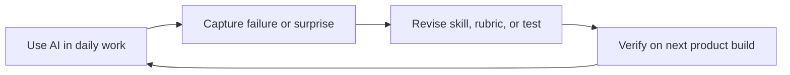

# Hi, I'm Tony Sheng 👋

**I build AI agent workflows, evals, and learning products. Educator since 2018.**  
*Learning by building and using what I make every day — staying curious, open-minded, and committed to shaping the future of education.*

[🇨🇳 中文简介](#关于我) · [🌐 Website](https://zturnsgo.com/) · [🌱 Knowledge Garden](https://notes.zturnsgo.com/) · [✍️ Daily Essays](https://github.com/shengdabai/Tony-Articles) · [𝕏 @tonyzturns](https://x.com/tonyzturns) · [▶️ YouTube](https://www.youtube.com/@zturns-zheteng) · [💼 LinkedIn](https://www.linkedin.com/in/changchun-sheng-520493255)

---

## Start here · 4 projects to know my work

Four flagship projects that best capture how I think, build with AI, and share in public:

<table>
  <tr>
    <td width="50%" valign="top">
      <b>01 · DAILY BILINGUAL WRITING</b>
      <h3>🌱 <a href="https://github.com/shengdabai/Tony-Articles">Tony-Articles</a></h3>
      
<b>630+ original bilingual essays (中文 / EN), shipped every day at noon.</b>

      
Deep-dives on learning, growth, and AI produced through a 13-step research, critique, and translation pipeline — synced daily to my public Quartz digital garden.

      
👉 <a href="https://notes.zturnsgo.com/"><b>Read 630+ essays online →</b></a>

      
<code>Bilingual</code> <code>13-Step Pipeline</code> <code>Quartz</code> <code>Daily Output</code>

    </td>
    <td width="50%" valign="top">
      <b>02 · AI WORKFLOW TOOLBOX</b>
      <h3>🧰 <a href="https://github.com/shengdabai/Tony-Claude-Code-Skills">Tony-Claude-Code-Skills</a></h3>
      
<b>320+ curated &amp; custom Claude Code skills, 9 agents, 39 commands &amp; a Codex bridge.</b>

      
The battle-tested local AI workbench behind 75+ public repos — sanitized configs, MCP setups, and one-script install ready to adopt or adapt.

      
👉 <a href="https://github.com/shengdabai/Tony-Claude-Code-Skills#quick-start"><b>Explore &amp; install skills →</b></a>

      
<code>Claude Code</code> <code>Codex</code> <code>Agent Skills</code> <code>MCP</code>

    </td>
  </tr>
  <tr>
    <td width="50%" valign="top">
      <b>03 · AI PRODUCT ADVISOR (NLPM FORK)</b>
      <h3>🧭 <a href="https://github.com/shengdabai/NLPM">NLPM · /nlpm:advise</a></h3>
      
<b>Built on <a href="https://github.com/xiaolai/nlpm">@xiaolai/nlpm</a>: evidence-checked product readiness for AI-built apps.</b>

      
Adds <code>/nlpm:advise</code> with 36 rules (<code>P01–P36</code>: security, reliability, hygiene, release &amp; selling) plus a deterministic verifier (<code>nlpm-advise-verify</code>) that checks every cited file &amp; line without an LLM.

      
👉 <a href="https://github.com/shengdabai/NLPM#nlpm-fork-by-shengdabai"><b>Install plugin (3 commands) →</b></a> · <a href="https://shengdabai.github.io/NLPM/"><b>Docs →</b></a>

      
<code>Claude Plugin</code> <code>36 Rules</code> <code>Machine-Verified</code> <code>Open Source</code>

    </td>
    <td width="50%" valign="top">
      <b>04 · VISUAL RESEARCH GALLERY</b>
      <h3>🔬 <a href="https://github.com/shengdabai/AI-Research-Gallery">AI-Research-Gallery</a></h3>
      
<b>166 interactive HTML research explainers distilled from ~1,600 AI notes.</b>

      
Self-contained paper breakdowns, fact-checks, and visualizations across AI models, learning science, and solo business — curated and privacy-screened for general readers.

      
👉 <a href="https://shengdabai.github.io/AI-Research-Gallery/"><b>Browse 166 pages online →</b></a>

      
<code>Interactive HTML</code> <code>Data Viz</code> <code>Fact-Checked</code> <code>Bilingual</code>

    </td>
  </tr>
</table>

---

## How I build · Learning by building

I don't study AI from the sidelines. **I use AI coding agents (Claude Code, Codex) and LLMs (Claude, GPT, Gemini) in my work every day, and I learn by building products I can actually use and test.**

When a workflow fails or a model surprises me, I capture the exact case, revise the workflow or add a test, and verify the fix on the next build. Staying curious and open-minded means treating every shipped tool as both a product and a live experiment.

### Under the hood · AI evals &amp; learning products

| System | Role in my daily loop |
|---|---|
| [**CC-Eval**](https://github.com/shengdabai/CC-Eval) | 28 real failure cases (`19 train / 9 held-out test`) measuring cost vs. accuracy across Claude Code `model × effort` settings — pairing `no-pause` against `must-ask`, with model-identity checks, budget guards &amp; offline regression tests |
| [**AgentProof**](https://github.com/shengdabai/AgentProof) | Local-first snapshot, acceptance-command runner &amp; verifiable evidence pack for AI-assisted code changes |
| [**ChineseThinking**](https://github.com/shengdabai/ChineseThinking) | AI Mandarin platform turning 8+ years of classroom pedagogy into daily thinking-pattern micro-challenges + an AI practice partner |
| [**HSK-Prep-Platform**](https://github.com/shengdabai/HSK-Prep-Platform) | HSK exam-prep web app with leveled content, timed mock exams &amp; spaced-repetition mistake book (Next.js 16 + Supabase + Stripe integration) |

<b>Working principles (6 rules I ship by)</b>

 

- **Ship daily, learn continuously.** Something concrete lands every day — a tool, a fix, an eval case, an essay. Streaks are a by-product; compounding skill is the goal.
- **One problem, one branch, one PR.** Small commits; tests and docs travel with the code; merged cleanly.
- **AI as co-worker, human as owner.** Claude Code, Codex, and Gemini draft, review, and cross-check each other; I define the acceptance bar and own what ships.
- **Teach what I build, build what I teach.** Classroom friction shapes what gets built; every product tests my assumptions about learning.
- **Learn in public, publish clean.** Workflows, datasets, and notes are open; personal data is stripped before anything leaves my machine.
- **Read the graph honestly.** Many commits are co-authored with AI coding agents (see `Co-Authored-By` trailers) and land via one-branch, one-PR merges. Judge the work by the shipped repos, test suites, and live demos above.

---

## About me

I started teaching in **2018** and have spent the years since working across almost every corner of education — bilingual classrooms, curriculum R&amp;D, K–12 international student recruitment, content and community operations, and education sales. Trained in engineering (**BEng**, Hefei University of Technology) and school leadership (**MA in Educational Leadership &amp; Administration**, The University of Manchester), I now bring those worlds together at **Z Turns**.

- **Bilingual Teaching, Pedagogy &amp; AI Assessment** — Taught English and contributed to curriculum development and teacher training at New Oriental (~3,000 K–12 learners, #1 in department), built an independent online language studio, and formerly delivered **2,000+ hours of 1-on-1 executive Mandarin coaching** (5.0/5.0 rating) at Learnlight to **100+ executives and professionals** across **30+ global organizations** — including **ExxonMobil, FC Barcelona, Equinor, JPMorgan Chase, Johnson &amp; Johnson, and the World Bank Group** — while also contributing to internal evaluation of **AI language assessment systems and AI teaching tools**.
- **International Education &amp; Study Abroad** — Coordinated K–12 international recruitment partnerships, webinars, and China/Asia go-to-market initiatives connecting students with Canadian and U.S. schools at ApplyBoard.
- **Self-Media, Community Operations &amp; Commercial Growth** — Managed content, video-platform, and community operations across a **1M+ combined follower** network (mentoring **300+ creators** and leading delivery of a RMB 3M private advisory-board program); generated RMB 600K quarterly course sales at New Oriental and advised **20+ creators and small businesses** on positioning, pricing, and WeChat-ecosystem growth.
- **Long-Term Mission** — Inspired by [@xiaolai](https://github.com/xiaolai)'s practice of self-teaching as a craft and being a producer rather than a passive consumer, I build with an open, curious mindset toward what comes next. **My long-term commitment is to stay in education and build better ways for learners to practice, get meaningful feedback, and see their own progress — helping shape the future of learning in the AI era.**

### 关于我

我从 **2018 年**开始从事教学，八年多来一直围绕教育展开实践——走过中英文一线教学与教研、K-12 海外留学招生、百万级自媒体与社群运营、课程销售与独立顾问。本科毕业于**合肥工业大学（211）工程管理专业**，硕士毕业于**英国曼彻斯特大学教育领导力与管理专业（MA）**，如今在 **Z Turns** 把一线教育经验与 AI 工程实践结合在一起。

对我而言，学习 AI 最好的方式不是旁观，而是**在每天高频使用中不断迭代，通过做出真实可用、可测的产品继续学习**。我始终保持好奇心和开放心态，面向未来持续打磨工具与认知：

- **AI 实战与「做中学」飞轮（Z Turns）**：每天使用 Claude Code、Codex、MCP 与主流大模型做真实开发，把踩过的坑沉淀为评测集（`CC-Eval`）、验收证据工具（`AgentProof`）、精选与自研结合的 Skills 工具箱（`Tony-Claude-Code-Skills`），已公开发布 **75+ 个开源仓库**、**630+ 篇日更中英双语长文**与 **20 册 HSK 分级主题教材**。
- **中英文教学、教研与 AI 测评**：2018 年起步于新东方（教授约 3,000 名 K-12 学员、参与教研与师训、部门业绩第一），后独立创办在线语言工作室；曾任 Learnlight 企业中文培训师，累计完成 **2,000+ 小时**一对一高管与精英教学（评分 **5.0/5.0**），服务来自 **埃克森美孚、巴塞罗那足球俱乐部、挪威国家石油（Equinor）、摩根大通、强生、世界银行集团**等 **30+ 跨国企业与机构**的 **100+ 位学员**，并在公司内部参与 **AI 语言测评与 AI 教学工具的开发评估**。
- **海外留学与国际教育**：在 ApplyBoard 协调中国及亚洲市场的 K-12 国际招生合作、双语研讨会与市场推广，对接加拿大与美国院校。
- **自媒体、社群运营与商业销售**：操盘过合计**百万级粉丝**内容矩阵与社群运营，辅导 **300+ 创作者**，主导交付 300 万元私董会项目；具备单季 60 万课程销售与 20+ 小微企业/创作者增长咨询经验。
- **面向未来的长期愿景**：受 [@xiaolai](https://github.com/xiaolai)「自学是门手艺、在 AI 时代做生产者」的启发，我选择长期扎根教育——**希望用持续进化的 AI 工具与教学设计，让学习者更容易练习、获得高质量反馈并看见自己的进步，参与改变未来教育。**

### Credentials &amp; background · 教育背景与专业资质

| Dimension | Verified Credentials &amp; Track Record |
|---|---|
| **Degrees · 学历** | **MA, Educational Leadership &amp; Administration** — The University of Manchester (2021–2023) **BEng, Engineering Management** — Hefei University of Technology, Project 211 (2014–2018) |
| **Teaching · 教学资质** | **CTCSOL** (Certificate for Teachers of Chinese to Speakers of Other Languages) · **Trinity DipTESOL** (Level 7, Ofqual RQF, Trinity College London) · **Cambridge CELTA** · **Cambridge TKT** (Modules 1–3, YL, CLIL) · **China High School English Teacher Qualification** |
| **Growth · 运营与营销** | **China Internet Senior Marketer** · 1M+ combined follower network ops · 300+ creators mentored · K–12 international study-abroad recruitment (ApplyBoard) · Education sales &amp; consulting |
| **Languages · 语言** | Mandarin Chinese (Native) · English (Professional Working Proficiency) |

---

## Full open-source index

75+ public repos across AI workflows, education products, and daily knowledge output. Click any group to browse:

<b>1 · AI workflows, evals &amp; builder tools (22 repos)</b>

 

| Project | Highlights |
|---|---|
| [NLPM](https://github.com/shengdabai/NLPM) · [docs](https://shengdabai.github.io/NLPM/) | Fork of `xiaolai/nlpm` adding `/nlpm:advise` (36 product-readiness rules `P01–P36`) &amp; deterministic evidence verifier (`nlpm-advise-verify`) |
| [CC-Eval](https://github.com/shengdabai/CC-Eval) | 28-case (19 train / 9 test) eval suite measuring cost vs. task accuracy across Claude Code model×effort settings |
| [AgentProof](https://github.com/shengdabai/AgentProof) | Local-first snapshot, acceptance check &amp; verifiable evidence pack for AI-assisted code changes |
| [Tony-Claude-Code-Skills](https://github.com/shengdabai/Tony-Claude-Code-Skills) | 320+ curated &amp; custom Claude Code skills, 9 agents, 39 commands, sanitized configs &amp; a Codex bridge |
| [AI-Built-Mini-Tools](https://github.com/shengdabai/AI-Built-Mini-Tools) · [live](https://shengdabai.github.io/AI-Built-Mini-Tools/) | 58 offline browser tools built with AI agents using written specs, unit tests &amp; scripted browser checks |
| [Claude-Code-Plugins](https://github.com/shengdabai/Claude-Code-Plugins) | Daily Claude Code plugins: devflow process guard, decision tracker, secret-shield &amp; task-ledger band |
| [Agent-Toolforge](https://github.com/shengdabai/Agent-Toolforge) | Ten building blocks for AI agents: 5 MCP servers and 5 Claude / Codex skills |
| [Tony-Skill](https://github.com/shengdabai/Tony-Skill) | Agent Skill distilling a person's cognitive OS (pedagogy × AI workflows × cross-domain thinking) |
| [Idea-Trio-Devtools](https://github.com/shengdabai/Idea-Trio-Devtools) · [Whylog](https://github.com/shengdabai/Whylog) | `promptdiff` (snapshot/diff AI configs), `SkillLint`, `CardStack` · local-first decision log feeding review lessons forward |
| [IdeaForge](https://github.com/shengdabai/IdeaForge) | Turn any idea, link, or image into a self-contained visual knowledge page locally (Codex / Claude / Ollama) |
| [AI-Team](https://github.com/shengdabai/AI-Team) · [live](https://ai-team.pages.dev) | Multi-model playground: @-mention GPT, Claude, Gemini, Grok, DeepSeek &amp; 5 Chinese models to compare or debate |
| [GH-Audit](https://github.com/shengdabai/GH-Audit) | One-command redaction-first security audit for GitHub repos &amp; orgs: secrets, PII, vulnerable deps, IaC &amp; governance |
| [Insidebar-AI](https://github.com/shengdabai/Insidebar-AI) | All your AI chatbots in one browser sidebar — no API keys, privacy-first, open source |
| [FreeSpace](https://github.com/shengdabai/FreeSpace) | Smart tab manager: one keystroke files open tabs across windows into auto-classified, searchable sessions |
| [Feishu-Lark-To-Obsidian](https://github.com/shengdabai/Feishu-Lark-To-Obsidian) | One-click &amp; batch export of Feishu/Lark docs to clean Obsidian-ready Markdown (extension + Playwright CLI) |
| [AI-Learning-Step-By-Step](https://github.com/shengdabai/AI-Learning-Step-By-Step) | Bilingual learning path: from AI tools, to agents, to an AI startup |
| [Dev-Guides-Collection](https://github.com/shengdabai/Dev-Guides-Collection) · [Everything-Claude-Code](https://github.com/shengdabai/Everything-Claude-Code) | Copy-paste-ready engineering guides · curated Claude Code agents, rules, hooks &amp; MCP toolkit |
| [QuickTranslate](https://github.com/shengdabai/QuickTranslate) · [Content-Creator-Hub](https://github.com/shengdabai/Content-Creator-Hub) · [AI-Video-Workflow](https://github.com/shengdabai/AI-Video-Workflow) ([site](https://shengdabai.github.io/AI-Video-Workflow/)) | Always-on-top Rust/Tauri translator · terminal X/YouTube publishing tools · end-to-end AI video automation pipeline |

<b>2 · Education &amp; learning products (18 repos)</b>

 

| Project | Highlights |
|---|---|
| [ChineseThinking](https://github.com/shengdabai/ChineseThinking) | AI Mandarin platform teaching framing &amp; thinking patterns via daily micro-challenges + AI partner (TypeScript) |
| [HSK-Prep-Platform](https://github.com/shengdabai/HSK-Prep-Platform) | HSK exam-prep web app: leveled content, timed mock exams, spaced-repetition mistake book (Next.js 16 + Supabase + Stripe integration) |
| [Chinese-Mission](https://github.com/shengdabai/Chinese-Mission) | Learn Chinese by completing real-world missions via AI conversation with pinyin, gloss &amp; voice |
| [Chinese-Learning](https://github.com/shengdabai/Chinese-Learning) | AI Mandarin tutor: topic vocabulary, voice conversation, and graded session reports in 24 native languages |
| [LinguaLens](https://github.com/shengdabai/LinguaLens) | AI Chinese-learning toolkit: immersive reading, shadowing, translation &amp; fluency coaching (BYO key) |
| [Chinese-Textbook-Generator](https://github.com/shengdabai/Chinese-Textbook-Generator) | Multi-LLM pipeline for generating HSK-aligned, print-ready themed textbooks (20 volumes built &amp; rubric-reviewed) |
| [Chinese-Character-Content](https://github.com/shengdabai/Chinese-Character-Content) · [browse](https://shengdabai.github.io/Chinese-Character-Content/) | Open Chinese character datasets for English speakers — 3,500/7,000 lists + corpus frequency &amp; HSK bands (CSV/JSON) |
| [Teaching-Notes-Sidebar](https://github.com/shengdabai/Teaching-Notes-Sidebar) · [Browser-Extensions](https://github.com/shengdabai/Browser-Extensions) | Chrome MV3 extensions turning Chinese text into leveled teaching notes, pinyin &amp; splitters across 9 AI providers |
| [TeachLoop-Workbench](https://github.com/shengdabai/TeachLoop-Workbench) | Offline static learning workbench turning any topic into immediate recall + 7-day consolidation loop |
| [College-Major-Selector](https://github.com/shengdabai/College-Major-Selector) ([live](https://shengdabai.github.io/College-Major-Selector/)) · Gaokao suite ([Review](https://github.com/shengdabai/Gaokao-Review), [600](https://github.com/shengdabai/Gaokao-600), [Assistant](https://github.com/shengdabai/Gaokao-Assistant), [Materials](https://github.com/shengdabai/Gaokao-Study-Materials)) | Browser-based Gaokao planning with local admissions parsing + optional AI advisor, plus Socratic tutoring &amp; essay grading tools |
| [Futurecraft](https://github.com/shengdabai/Futurecraft) · [Future-Path-Quest-Open](https://github.com/shengdabai/Future-Path-Quest-Open) · [VoiceReaderApp](https://github.com/shengdabai/VoiceReaderApp) | Career exploration RPG · gamified future-path simulator · trilingual iOS PDF/EPUB reader with AI voice cloning (Swift) |

<b>3 · Daily production, digital garden &amp; utilities (5 repos)</b>

 

| Project | Highlights |
|---|---|
| [Tony-Articles](https://github.com/shengdabai/Tony-Articles) · [read online](https://notes.zturnsgo.com/) | 630+ bilingual deep-dive essays on learning, growth &amp; AI, published daily via a 13-step writing pipeline |
| [AI-Research-Gallery](https://github.com/shengdabai/AI-Research-Gallery) · [browse](https://shengdabai.github.io/AI-Research-Gallery/) | 166 self-contained HTML research pages &amp; visualizations curated from ~1,600 notes after privacy passes |
| [Tony-Knowledge-Garden](https://github.com/shengdabai/Tony-Knowledge-Garden) · [visit](https://notes.zturnsgo.com/) | Public Quartz digital garden: bilingual notes on AI, Chinese teaching &amp; learning science |
| [Small-Yet-Smart-Programs](https://github.com/shengdabai/Small-Yet-Smart-Programs) | Daily scout for small, profitable, replicable software ideas scored on a 7-dimension anti-hype rubric |
| [Apple-Refurb-Watch](https://github.com/shengdabai/Apple-Refurb-Watch) | Utility that notifies you when Apple's refurbished store lists new Macs |

<i>Apps containing payment records or learner data remain private on purpose.</i>

---

## GitHub activity

  <picture>
    <source media="(prefers-color-scheme: dark)" srcset="https://github-readme-stats.vercel.app/api?username=shengdabai&show_icons=true&hide_border=true&count_private=true&theme=github_dark" />
    <source media="(prefers-color-scheme: light)" srcset="https://github-readme-stats.vercel.app/api?username=shengdabai&show_icons=true&hide_border=true&count_private=true&theme=default" />
    
  </picture>
  <picture>
    <source media="(prefers-color-scheme: dark)" srcset="https://github-readme-stats.vercel.app/api/top-langs/?username=shengdabai&layout=compact&hide_border=true&langs_count=6&theme=github_dark" />
    <source media="(prefers-color-scheme: light)" srcset="https://github-readme-stats.vercel.app/api/top-langs/?username=shengdabai&layout=compact&hide_border=true&langs_count=6" />
    
  </picture>

  <picture>
    <source media="(prefers-color-scheme: dark)" srcset="https://github-readme-streak-stats.herokuapp.com/?user=shengdabai&hide_border=true&theme=github-dark" />
    <source media="(prefers-color-scheme: light)" srcset="https://github-readme-streak-stats.herokuapp.com/?user=shengdabai&hide_border=true" />
    
  </picture>

---

## Let's connect

If you are working on **AI agent workflows &amp; evals**, building **the future of education**, or looking for a collaborator who bridges real classrooms and working software — open an issue on any repo above, or say hi on [X](https://x.com/tonyzturns) / [LinkedIn](https://www.linkedin.com/in/changchun-sheng-520493255). I reply in English or 中文.
